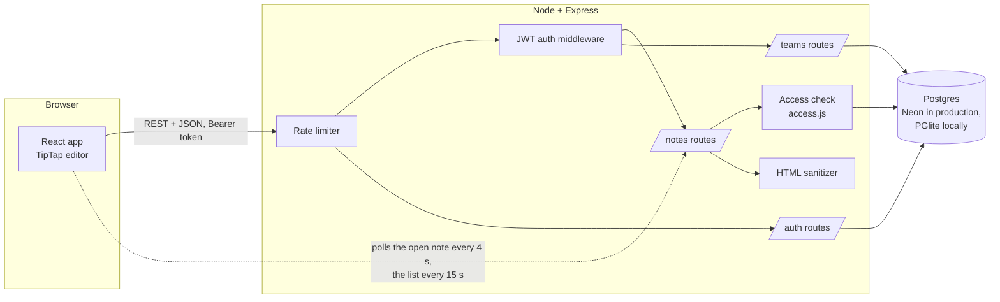
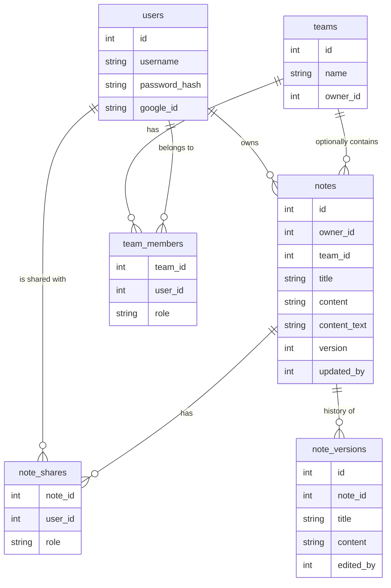

# Architecture

## Overview

In production Express also serves the built React app (`client/dist`), so the whole product is one deployable service plus the database.

## Data model

`content` is sanitized HTML. `content_text` is a plain-text copy used for search and list previews, so tag and attribute names are never searchable.

## Permission model

Every route that touches a note goes through one function, `withNote(minRole)` in `server/access.js`. A user's role on a note is the highest of:

| Role | How you get it |
|---|---|
| owner | you created the note, or you own the team the note belongs to |
| editor | you are a member of the note's team, or it was shared with you as editor |
| viewer | it was shared with you as viewer |

| Action | viewer | editor | owner |
|---|:-:|:-:|:-:|
| Read, see history | yes | yes | yes |
| Edit, restore a version | | yes | yes |
| Delete, share, move to a team | | | yes |

Two deliberate response codes: **no access at all returns 404** (the note's existence is not revealed), **not enough access returns 403**. Search and list queries use the same visibility rule, so a guessed `scope=team:5` shows nothing to a non-member.

## Concurrent editing

Notes use **optimistic concurrency**, not locks and not a merge algorithm:

1. Each note has an integer `version`. The client sends the version it last saw with every save.
2. The server updates `WHERE id = $1 AND version = $2` and increments the version. If no row matches, someone else saved first and the server answers **409** with the current note.
3. The client shows a banner: *use theirs* (replace local text) or *keep mine* (resend on top of their version). Nothing is overwritten silently.
4. The open note is polled every 4 seconds. If it changed on the server and the user has no unsaved edits, the new text is shown (the cursor is preserved). If they do have unsaved edits, their next save hits the 409 path.

Autosaves from one client are serialized so a client can never conflict with itself.

## Version history

Before an edit overwrites a note, the server archives the old state, credited to whoever wrote it. To keep history useful, one person's rapid autosaves are throttled to one archived version per 30 seconds, but an overwrite by a *different* person is always archived, so nobody's contribution can disappear. The last 50 versions are kept. Restoring a version archives the current text first, so a restore can be undone.

## Rich text and sanitization

The editor is TipTap (ProseMirror). Because notes are rendered in other users' browsers, **the server sanitizes all HTML before storing it** (`server/sanitize.js`, built on `sanitize-html`): a tag and attribute whitelist, highlight colours restricted to hex values, no images, links, scripts, event handlers or arbitrary styles. Plain text from older notes or API clients is escaped and wrapped in paragraphs. Browser tests confirm an injected `<script>` and `onerror` handler are neither stored nor executed in a collaborator's browser.

## Authentication and security

- Passwords are hashed with bcrypt; JWTs (7 days) are signed with `JWT_SECRET`, which is required at startup.
- Login and registration are rate limited (20 attempts per 15 minutes per IP by default); the API has a general limit as well. The app trusts one proxy hop so limits use the real client IP on Render.
- All input is validated on the server: username/password format, title and content length, types, numeric ids. Non-numeric ids are 404, not 500.
- SQL is always parameterized. Search terms are escaped for `LIKE` wildcards.
- Optional Google sign-in verifies the ID token server-side against `GOOGLE_CLIENT_ID`.

## Technical decisions and trade-offs

- **Postgres rather than MongoDB.** The data is relational (users, notes, teams, memberships, shares) and the permission check is a join. The same SQL runs on Neon in production and on PGlite (Postgres compiled to WASM) locally and in tests, so development needs no installed database.
- **Polling rather than WebSockets.** For note-sized documents saved every half second, 4-second polling plus version checks gives a collaborative feel with far less infrastructure and works on free hosting that sleeps. The cost is a delay of a few seconds, and edits are resolved per note (keep mine / use theirs), not per character. A CRDT such as Yjs would be the next step for true real-time co-editing.
- **Sanitize on write.** Storing clean HTML means every reader (list, history, other users) gets safe content without relying on each client to escape.
- **One service.** Express serves the API and the static client, which keeps deployment to a single web service.

## Limitations

- No real-time cursors or character-level merging (see above).
- The free Render plan sleeps after 15 minutes idle; the first request afterwards takes about 30 seconds.
- Without `DATABASE_URL` the embedded database lives on the server's disk, which free hosts wipe on restart. Production should set `DATABASE_URL` to a hosted Postgres.
